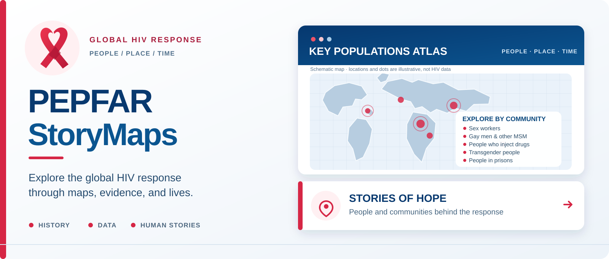

# PEPFAR StoryMaps

**[Open the interactive PEPFAR Map Tour →](https://jltobias.github.io/JupyterLite-PEPFAR-Storymaps/)**

*Visual themes: the [UNAIDS Key Populations Atlas](https://kpatlas.unaids.org/dashboard) and PEPFAR's [Stories of Hope](https://www.state.gov/stories-of-hope-pepfar). The illustration is schematic; explore the linked sources for actual data and stories.*

**Explore the history of PEPFAR and the global HIV response through place, time, evidence, and lived experience.**

This open project is being developed as an interactive, accessible collection of maps, narratives, oral histories, archival material, videos, and data visualizations. The aim is to help a global audience—including communities, researchers, educators, and public-health and agency staff—understand the epidemic's history and the role of PEPFAR in the wider response.

> **Project status:** The Map Tour above is the first project-specific experience. Jupyter Book and JupyterLite deployments are still in development. Other links below open upstream tools and evidence sources; they are examples and research destinations, not completed PEPFAR StoryMaps.

## Explore

| Experience | Open |
| --- | --- |
| **PEPFAR Map Tour** | [Explore the live, source-linked map tour](https://jltobias.github.io/JupyterLite-PEPFAR-Storymaps/) — follow dated stops across places that shaped PEPFAR and the HIV response. |
| **Jupyter Book** | [Jupyter Book documentation](https://jupyterbook.org/) — the framework intended for the project's narrative and reproducible research book. |
| **JupyterLite Lab** | [Try JupyterLite Lab](https://jupyterlite.readthedocs.io/en/stable/try/lab) — run notebooks in the browser; this is the upstream demo. |
| **StoryMap Tour Explorer** | [Try JupyterGIS in JupyterLite](https://jupytergis.readthedocs.io/en/latest/lite/lab/index.html) · [JupyterGIS interface and first-layers tour](https://jupytergis.readthedocs.io/en/latest/getting_started/index.html) · [ArcGIS StoryMaps](https://storymaps.arcgis.com/) |
| **2D maps** | [UNAIDS AIDSinfo: Epidemic & Response](https://aidsinfo.unaids.org/?chp=false) · [PEPFAR data portal](https://data.pepfar.gov/) |
| **3D maps** | [JupyterGIS browser demo](https://jupytergis.readthedocs.io/en/latest/lite/lab/index.html) · [CesiumJS interactive examples](https://sandcastle.cesium.com/) |
| **Data visualizations** | [UNAIDS AIDSinfo](https://aidsinfo.unaids.org/) · [UNAIDS inequalities](https://aidsinfo.unaids.org/inequalities) · [UNAIDS HIV finance dashboards](https://hivfinancial.unaids.org/hivfinancialdashboards.html) |
| **3D scenes** | [CesiumJS Sandcastle](https://sandcastle.cesium.com/) — an interactive 3D geospatial example gallery; not a PEPFAR scene. |
| **Videos** | [*Fauci* (National Geographic Documentary Films)](https://films.nationalgeographic.com/fauci) |
| **Publication archives** | [UNAIDS publications](https://www.unaids.org/en/resources/publications/latest) · [HIV.gov: HIV and AIDS timeline](https://www.hiv.gov/hiv-basics/overview/history/hiv-and-aids-timeline) · [PEPFAR](https://www.pepfar.gov/) |
| **Oral histories and context** | [PEPFAR Stories of Hope](https://www.state.gov/stories-of-hope-pepfar) · [State Department archive of Stories of Hope](https://2001-2009.state.gov/s/gac/rl/or/68653.htm) · [An Oral History of PEPFAR](https://www.bushcenter.org/publications/an-oral-history-of-pepfar-how-a-dream-big-partnership-is-saving-the-lives-of-millions) · [Imagining a World Without PEPFAR: Paving the Way for Impact](https://www.bushcenter.org/publications/imagining-a-world-without-pepfar-paving-the-way-for-impact) |
| **Books** | [*Lifeline: The Story of PEPFAR, the Greatest Humanitarian Initiative of Our Time*](https://www.goodreads.com/book/show/245290845-lifeline) by John Donnelly (2026). |
| **UNAIDS and key population resources** | [UNAIDS global HIV statistics](https://www.unaids.org/en/resources/fact-sheet) · [UNAIDS Key Populations Atlas](https://kpatlas.unaids.org/dashboard) · [UNAIDS: Key populations](https://www.unaids.org/en/topic/key-populations) |

JupyterGIS in JupyterLite runs without a server; some GIS capabilities may not be available in that mode. See the [JupyterGIS JupyterLite limitations](https://jupytergis.readthedocs.io/en/latest/user_guide/explanation/jupyter-lite-limitations.html).

## Storytelling principles

- Connect milestones to geography and time, while distinguishing global, regional, national, and community-level evidence.
- Put people and community leadership at the center; represent key populations respectfully and avoid stigmatizing language.
- Show uncertainty, definitions, reporting periods, and source dates alongside quantitative claims.
- Make experiences usable with keyboard navigation, captions and transcripts, alt text, readable contrast, and low-bandwidth alternatives.
- Treat maps as arguments as well as illustrations: explain boundaries, denominators, missing data, and what a map cannot show.
- Keep data transformations reproducible and link every chart, map, and narrative claim to its source.

## Sources and attributions

The splash illustration above is original artwork created for this repository. Its red ribbon, map, and community and story panels are visually informed by the [UNAIDS Key Populations Atlas](https://kpatlas.unaids.org/dashboard) and [PEPFAR Stories of Hope](https://www.state.gov/stories-of-hope-pepfar), but no external images, maps, or data are reproduced. The map is schematic and its dots have no quantitative meaning. External resources linked here remain the property of their respective publishers. Linking to a resource does not imply endorsement by PEPFAR, UNAIDS, Jupyter, or any other organization.

Core references for the historical and data context:

See the [research references](REFERENCES.md) for the supplied CRANE Survey publications and studies of PEPFAR outcomes, policy, and funding disruptions. These papers are background for future stories; the current tour's stop-specific citations are in [Map Tour sources](map-tour/SOURCES.md).

1. **HIV.gov.** [A Timeline of HIV and AIDS](https://www.hiv.gov/hiv-basics/overview/history/hiv-and-aids-timeline). U.S.-focused timeline; use alongside international and community sources rather than as a complete global chronology.
2. **UNAIDS.** [Global HIV & AIDS statistics — Fact sheet](https://www.unaids.org/en/resources/fact-sheet); [AIDSinfo data portal](https://aidsinfo.unaids.org/); [HIV estimates with uncertainty bounds, 1990–present](https://www.unaids.org/en/resources/documents/2026/HIV_estimates_with_uncertainty_bounds_1990-present); [Key Populations Atlas](https://kpatlas.unaids.org/dashboard); and [Key populations topic page](https://www.unaids.org/en/topic/key-populations). Consult the original release for the applicable year, uncertainty intervals, definitions, and reuse terms before reproducing data.
3. **U.S. President's Emergency Plan for AIDS Relief (PEPFAR).** [Official website](https://www.pepfar.gov/), [PEPFAR data portal](https://data.pepfar.gov/), and [Stories of Hope](https://www.state.gov/stories-of-hope-pepfar) ([archived collection](https://2001-2009.state.gov/s/gac/rl/or/68653.htm)). Cite the exact dashboard, indicator, country, reporting period, and access date when using portal data; credit individual stories and their media to their publishers and creators.
4. **George W. Bush Presidential Center / George W. Bush Institute.** [An Oral History of PEPFAR: How a “Dream Big” Partnership Is Saving the Lives of Millions](https://www.bushcenter.org/publications/an-oral-history-of-pepfar-how-a-dream-big-partnership-is-saving-the-lives-of-millions) (originally published 2018; updated); [Imagining a World Without PEPFAR: Paving the Way for Impact](https://www.bushcenter.org/publications/imagining-a-world-without-pepfar-paving-the-way-for-impact). Attribute quotations and images to the original page and its credited contributors.
5. **National Geographic Documentary Films.** [*Fauci* (2021)](https://films.nationalgeographic.com/fauci). Link to the publisher's page; do not copy, redistribute, or embed film materials without permission.
6. **World Health Organization.** [HIV data and statistics](https://www.who.int/teams/global-hiv-hepatitis-and-stis-programmes/hiv/strategic-information/hiv-data-and-statistics). Use the source's definitions and reporting dates when citing WHO estimates.
7. **Project Jupyter / GeoJupyter.** [JupyterLite](https://jupyterlite.readthedocs.io/en/stable/), [JupyterGIS](https://jupytergis.readthedocs.io/en/latest/), and [Jupyter Book](https://jupyterbook.org/). These links document the tools, not the underlying HIV/PEPFAR data.
8. **John Donnelly.** [*Lifeline: The Story of PEPFAR, the Greatest Humanitarian Initiative of Our Time*](https://www.goodreads.com/book/show/245290845-lifeline) (Harper, 2026). A book-length history and interpretation of PEPFAR; attribute any quotations or images to the book and its creators.

### Attribution and responsible reuse

For every dataset, photograph, map layer, audio recording, video, quotation, or archival item added to the project, record the creator or issuing organization, exact title, publication/update date, source URL, license or permissions, access date, and any required credit line. Link to original materials rather than copying them when reuse rights are unclear. Government publication does not automatically mean every included image or third-party item is public domain.

Use aggregate, appropriately protected data for sensitive populations. Do not map or publish personally identifiable or small-area information that could expose people to stigma, discrimination, or harm. Follow source terms, applicable privacy and ethics requirements, and community guidance; obtain consent and permissions for first-person media.

## Contribute

This repository is the home for the emerging project. Contributions that improve source documentation, accessibility, reproducibility, historical context, or respectful community representation are welcome. Open an issue or pull request in the [repository](https://github.com/jltobias/JupyterLite-PEPFAR-Storymaps).
